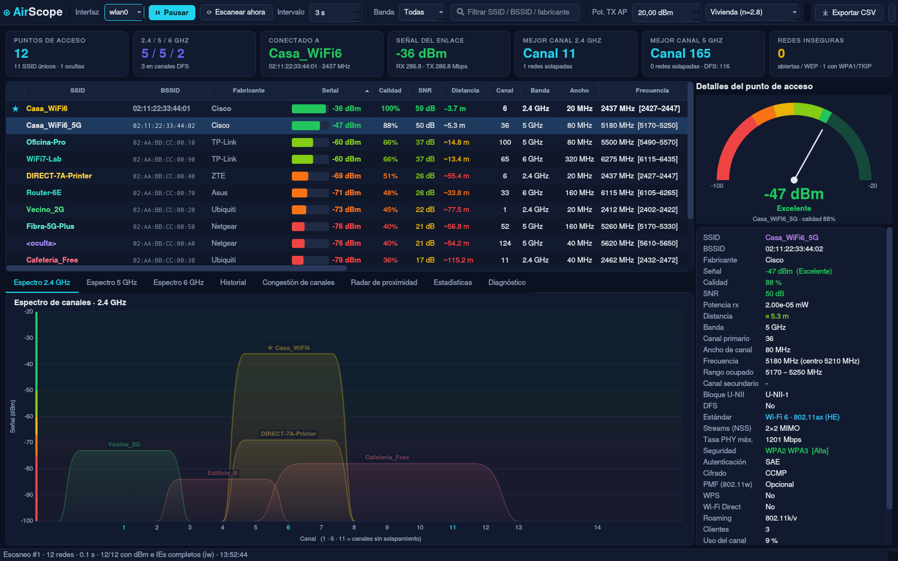
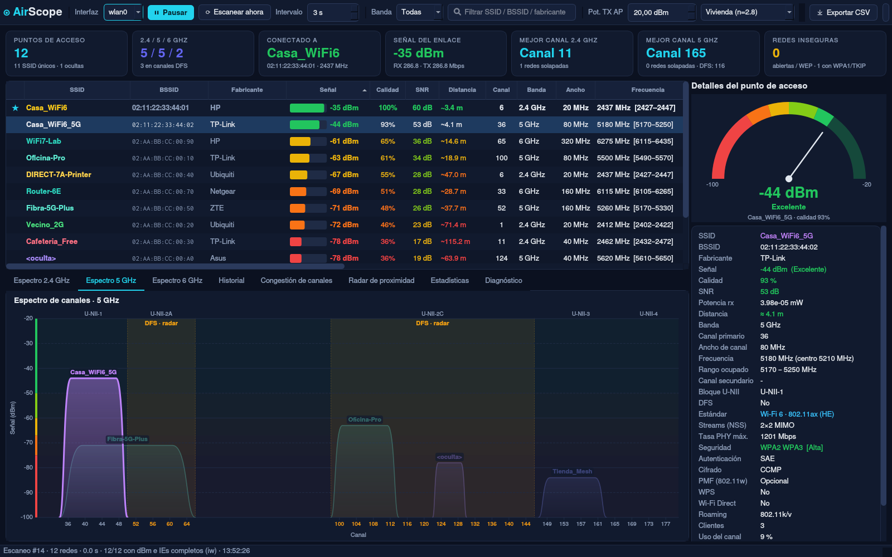
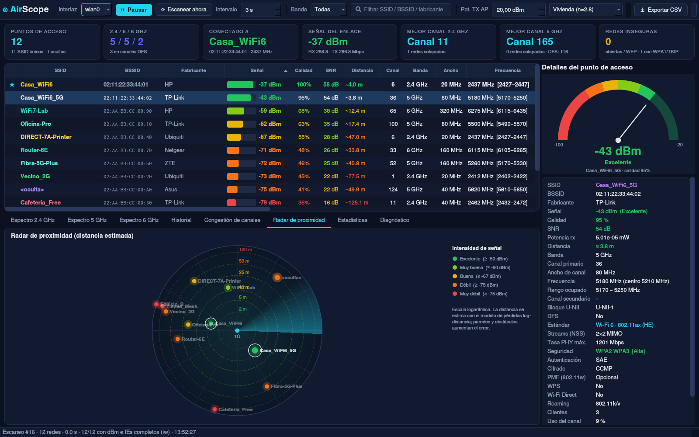

# ◉ AirScope — Analizador WiFi profesional para Linux

Analizador de redes WiFi de escritorio al estilo **inSSIDer**: potencia en dBm, distancia estimada,
canales, anchos de canal, Wi-Fi 4/5/6/6E/7, bandas de 2.4 / 5 / 6 GHz, DFS, seguridad, Wi-Fi Direct (P2P GO)
y mucho más, con gráficas profesionales y un código de colores que lo simplifica todo:
**verde = cerca / señal fuerte**, **rojo = lejos / señal débil**.



## Características

| Área | Qué muestra |
|---|---|
| **Señal** | RSSI en dBm reales (nl80211), calidad %, SNR, potencia en mW, medidor tipo velocímetro |
| **Distancia** | Estimación con el modelo log-distancia (configurable: potencia TX del AP y tipo de entorno). Usa la potencia TX anunciada por el AP (TPC) cuando existe |
| **Canales** | Canal primario, secundario (+1/−1), ancho 20/40/80/160/320 MHz, frecuencia central y rango ocupado |
| **Bandas** | 2.4 GHz, 5 GHz (bloques U-NII-1/2A/2C/3/4) y 6 GHz |
| **DFS** | Detección de canales DFS (52-144) y canales de radar meteorológico con CAC de 10 min (120-128) |
| **Estándar** | Wi-Fi 4 (802.11n), Wi-Fi 5 (ac), Wi-Fi 6 (ax), Wi-Fi 6E, Wi-Fi 7 (be) leídos de los Information Elements HT/VHT/HE/EHT; streams MIMO y tasa PHY máxima teórica |
| **Seguridad** | WPA1/WPA2/WPA3, suites de autenticación (PSK, SAE, FT, 802.1X), cifrados (CCMP/TKIP/GCMP), PMF 802.11w, WPS |
| **Extra** | Wi-Fi Direct / P2P Group Owner (GO), roaming 802.11k/v/r, clientes asociados y uso del canal (BSS Load), país, intervalo de beacon, fabricante (OUI) |

### Gráficas y diagramas

* **Espectro de canales** por banda (formas trapezoidales como inSSIDer, con zonas DFS y U-NII)
* **Historial de señal** en tiempo real (5 min)
* **Congestión de canales** con índice de interferencia ponderado por potencia y **canal recomendado ★**
* **Radar de proximidad** animado con los AP ubicados por distancia estimada
* **Estadísticas**: bandas, estándares, seguridad, calidad, anchos de canal, fabricantes
* **Diagnóstico automático**: interferencias sobre tu red, canal recomendado, redes abiertas/WEP/TKIP, WPS, DFS, 40 MHz en 2.4 GHz…

| | |
|---|---|
|  |  |
|  |  |
|  |  |

### Código de colores de la señal

| dBm | Nivel | Color |
|---|---|---|
| ≥ −50 | Excelente (muy cerca) | 🟢 verde |
| ≥ −60 | Muy buena | 🟢 lima |
| ≥ −67 | Buena | 🟡 amarillo |
| ≥ −75 | Débil | 🟠 naranja |
| < −75 | Muy débil (lejos) | 🔴 rojo |

## Instalación

Requisitos: Linux con **NetworkManager**, `iw`, Python 3.9+ y **PyQt6** (el instalador los instala si faltan
en Arch, Debian/Ubuntu, Fedora y openSUSE). **No necesita root** para escanear.

```bash
git clone https://github.com/melvinfranco99/airscope.git
cd airscope
./install.sh            # instalación para tu usuario (~/.local)
# sudo ./install.sh --system   # o para todo el sistema (/opt)
```

Después ejecuta:

```bash
airscope
```

o búscalo como **AirScope** en el menú de aplicaciones.

### Arch Linux (PKGBUILD)

```bash
cd packaging/arch && makepkg -si
```

### pip

```bash
pip install --user git+https://github.com/melvinfranco99/airscope.git
```

### Desinstalar

```bash
./uninstall.sh          # o: sudo ./uninstall.sh --system
```

## Uso

```
airscope            # escaneo real
airscope --demo     # datos de demostración (sin tarjeta WiFi)
```

* Haz clic en una red de la tabla, del espectro o del radar para resaltarla en todas las gráficas.
* Ajusta **Pot. TX AP** y el **entorno** (abierto / vivienda / oficina / edificio denso) para afinar la distancia.
* **Exportar CSV** guarda todos los datos del escaneo.

## Cómo funciona

AirScope combina, sin privilegios:

1. `nmcli device wifi rescan` → fuerza un escaneo activo a través de NetworkManager
2. `iw dev <if> scan dump` → lee la caché del kernel (nl80211) con todos los Information Elements
3. `nmcli device wifi list` → complemento cuando el kernel ya no tiene el BSS
4. `iw dev <if> link` → estado del enlace actual

Distancia: `d = 10^((P_TX − RSSI − PL₁ₘ) / (10·n))`, con `PL₁ₘ = 20·log10(f_MHz) − 27.55`.
Es una **estimación**: paredes, muebles y antenas alteran el resultado.

## Licencia

MIT
